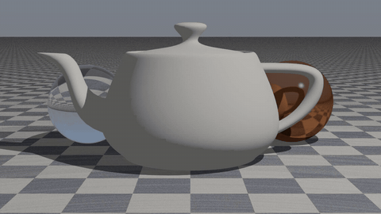

# Beam



Data-driven 3D scene renderer with an agent-first interface.

Beam renders scenes described as **versioned JSON** — no scripting language, no
Turing-complete scene DSL. Scenes are data: schema-validatable, diffable, and
trivially generatable by LLMs (an agent can emit a valid scene on the first try
given the schema).

## Design principles

1. **Scenes are data, not programs** — the POV-Ray lesson. Patterns are named
   built-in functions with parameters, not shaders with loops. This keeps
   scenes sandboxable, validatable, and cache-friendly for model generation.
2. **Deterministic by construction** — pure Go, strict IEEE-754 (Go forbids
   fused-multiply-add reassociation), per-pixel RNG seeded by coordinates.
   Same scene + seed = byte-identical PNG on any platform.
3. **CPU + GPU** — the tile scheduler renders on all cores; the OpenCL path
   (Intel Arc) renders the same scene ~11× faster with fp32 parity (mean
   byte diff 0.00 on the benchmark scene). The JSON layer, scheduler, and
   output pipeline are identical either way.
4. **Zero heavy dependencies** — stdlib + pure-Go libraries only (glTF
   loader, font outline reader). The single CGO surface is the optional
   OpenCL GPU path; everything else builds pure-Go.

## CLI

```
beam [options] scene.json

  -preview   fast low-res render (320px wide, 1 sample)
  -q         suppress progress output
  -o FILE    output path override (default: <scene>.png; .mp4 for -orbit/-anim)
  -fit       pre-render screen-fit check: project object bounds to pixels,
             report coverage/clipping, exit 2 if anything clips
  -gpu       render on GPU (OpenCL; hard-fails with diagnostics if no device)
  -orbit N   render a 360° turntable orbit video: N frames, camera circling
             the lookAt target at the scene camera's height/radius; frame 0
             is the scene's own view; assembled to H.264 MP4 via ffmpeg
  -anim      render the scene's animation block (keyframed timeline) to an
             MP4: duration x fps frames, every track sampled at each frame
             time. See "Animation" below.
  -fps N     output video framerate override for -orbit and -anim
             (default: 30 for -orbit; the scene's animation.fps for -anim)
```

Flags precede the scene path (Go flag package convention).
`-preview` is fast enough for an agent write → preview → look → refine loop.
`render.maxSeconds` in the scene aborts runaway renders on both CPU and GPU.

## Scene schema (v1)

```json
{
  "version": 1,
  "camera": {"pos": [0, 1.2, -5], "lookAt": [0, 0.8, 0], "fov": 42,
             "aperture": 0.06},
  "materials": {
    "floor": {"type": "matte", "pattern": {"type": "checker",
               "colors": [[0.92,0.92,0.9], [0.15,0.15,0.18]], "scale": 0.9}},
    "chrome": {"type": "metal", "color": [0.94,0.95,0.97], "roughness": 0.04},
    "glass": {"type": "glass", "color": [0.96,0.98,1.0], "ior": 1.5}
  },
  "objects": [
    {"type": "sphere", "center": [0, 0.9, 0], "radius": 0.9, "material": "glass"},
    {"type": "text", "text": "BEAM", "size": 1.4, "depth": 0.35,
     "material": "chrome", "transform": {"translate": [0, 1.6, -2.5]}}
  ],
  "lights": [{"type": "point", "pos": [5, 7, -4], "intensity": 1.6, "radius": 1.2}],
  "environment": {"color": [0.04, 0.05, 0.08], "ambient": 0.25},
  "render": {"width": 1280, "height": 720, "samples": 2, "seed": 42}
}
```

Object types: `sphere`, `plane`, `box`, `mesh` (OBJ / STL / GLB), `text`
(3D extruded TrueType, embedded default font).

Materials: `matte`, `metal` (roughness), `glass` (IOR), `emissive` (power).
Patterns: `solid`, `checker`, `gradient`.

Lights: `point`, `directional`, `spot`. A point/spot light with `radius` > 0
becomes a spherical area light — soft shadows, sampled `render.shadowSamples`
rays per light (default 1). Camera: perspective with optional thin-lens
depth of field.

## Import formats

- **OBJ + MTL** (v, f, usemtl → auto-materials)
- **STL** (binary + ASCII)
- **glTF 2.0 / GLB** via `qmuntal/gltf` (positions/indices/normals)

## Text

Real 3D extruded text: TrueType glyph outlines (`go-sfnt`) → adaptive curve
flattening → robust ear-clip triangulation (Mapbox earcut algorithm, ported)
→ extruded solid with correct outward-facing normals. Bevel is on the roadmap.

## Animation

Scenes carry an optional `animation` block: a keyframed timeline animating
the camera, named objects, and named lights. Render it with `-anim` (or
`animate: true` over MCP) — duration x fps frames, assembled to MP4.

```json
{
  "objects": [
    {"type": "sphere", "name": "ball", "center": [-2, 0.75, 0],
     "radius": 0.75, "material": "red"}
  ],
  "lights": [
    {"type": "point", "name": "key", "pos": [-4, 6, -4], "intensity": 1.1}
  ],
  "animation": {
    "duration": 2,
    "fps": 30,
    "tracks": [
      {"target": "ball", "property": "translate", "ease": "smooth",
       "keys": [{"t": 0, "value": [0, 0, 0]}, {"t": 2, "value": [4, 0, 0]}]},
      {"target": "camera", "property": "pos",
       "keys": [{"t": 0, "value": [0, 2, -8]}, {"t": 2, "value": [5, 3, -8]}]},
      {"target": "key", "property": "intensity",
       "keys": [{"t": 0, "value": [1.1]}, {"t": 1, "value": [0.3]}, {"t": 2, "value": [1.1]}]}
    ]
  }
}
```

- **Targets**: `"camera"`, or any named object/light (`name` field).
- **Properties**: camera `pos` / `lookAt` / `fov` / `aperture`; objects
  `translate` / `rotate` / `scale` (the transform channels — a track
  replaces only its own channel, the rest keep their authored values);
  lights `pos` / `color` / `intensity` / `radius` (animate 0 → big for
  shadows that grow from hard points into soft pools).
- **Keys**: `{t, value}` with strictly increasing times; vector properties
  take `[x,y,z]`, scalars take `[v]`. Outside the key span the authored
  value holds (no extrapolation).
- **Ease**: `linear` (default) / `smooth` / `easeIn` / `easeOut`, applied
  between keyframes.
- Frame 0 with identity keys at t=0 is byte-identical to a still render of
  the same scene. A plain render ignores the animation block entirely.
- Fixed seed across frames — no noise shimmer; render determinism holds.

## Layout

```
geom/          vectors, matrices, triangle meshes (GPU-flattenable data)
scene/         schema, validation (JSON-pointer errors), loading
render/        camera, BVH, Whitted integrator, tile scheduler, tonemap,
               beammath.go (portable transcendental ports shared with GPU)
asset/         OBJ / STL / glTF importers, extruded text (asset/text.go:
               glyph outlines → earcut → extrusion)
gpu/           OpenCL device renderer (kernels + scene flattener, CPU parity)
mcp/           MCP stdio server (render/preview/validate/schema tools)
cmd/beam/      CLI
cmd/beam-mcp/  MCP server entry point
pov-benchmark/ POV-Ray 3.8 benchmark port + parity tooling
simple-ab/     side-by-side POV/Beam A-B parity scene
gpu-smoke/     sub-second GPU canary scene
gpu-soak/      self-judging GPU-vs-CPU soak test
```

## Status

- **MCP server shipped** (`cmd/beam-mcp`): `beam_render`, `beam_preview`,
  `beam_validate`, `beam_schema` — agents author scenes from the schema,
  validate with full error lists + screen-fit checks, preview at 320px,
  then render full quality. Deterministic: MCP render ≡ CLI render,
  byte-identical.
- **GPU shipped** (`gpu/`): Intel Arc A770 OpenCL renderer, ~11× the CPU
  on the POV benchmark scene, fp32 parity within rounding noise. Bit-exact
  fp64 kernels behind `-D BEAM_DOUBLE=1` for datacenter GPUs.
- **POV-Ray parity tooling**: benchmark scene port (33 objects, real CSG
  sockets, quaternion julias, superellipsoids, isosurface bollard),
  handedness-correct POV→Beam mapping, A/B comparison harness.

## Roadmap

- Timeline animation — SHIPPED (`animation` block + `-anim`; the turntable orbit
  per-property tracks next), volumetric fire/plasma via ray-marched fbm
  fields, particle instancing (rain)
- Later: WASM shader escape hatch, bevel text, CSG
